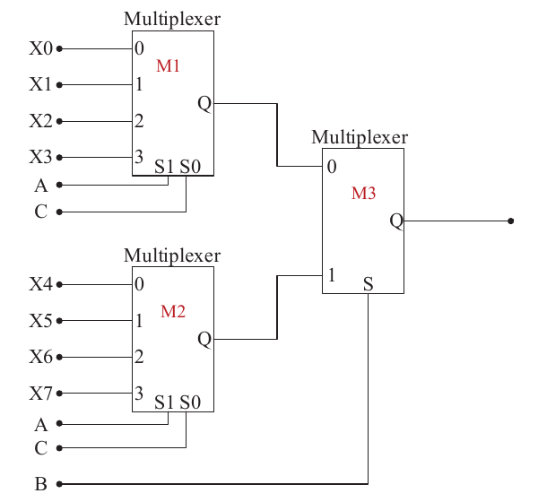

# 2023 CS Q44: Multiplexer network realising a Boolean function

## Question

A Boolean digital circuit is composed using two 4-input multiplexers (M1 and M2) and one 2-input multiplexer (M3) as shown in the figure. X0 to X7 are the inputs of the multiplexers M1 and M2 and could be connected to either 0 or 1. The select lines of the multiplexers are connected to Boolean variables A, B and C as shown.

Which one of the following set of values of (X0, X1, X2, X3, X4, X5, X6, X7) will realise the Boolean function $\overline{A} + \overline{A}\,\overline{C} + A\overline{B}C$?

- (A) (1, 1, 0, 0, 1, 1, 1, 0)
- (B) (1, 1, 0, 0, 1, 1, 0, 1)
- (C) (1, 1, 0, 1, 1, 1, 0, 0)
- (D) (0, 0, 1, 1, 0, 1, 1, 1)

Answer

**C ((1, 1, 0, 1, 1, 1, 0, 0))**

Solution

**Simplify.** $\overline{A}\,\overline{C}$ is absorbed by $\overline{A}$:

$$f = \overline{A} + A\overline{B}C$$

**Wiring.** M3 selects M1's output when $B = 0$ and M2's output when $B = 1$. Inside M1 and M2 the select pair is $(S_1, S_0) = (A, C)$, so input $X_{2A + C}$ is chosen.

**Fill the inputs from $f$:**

| $B$ | $(A,C)$ | $f$ | Input |
|---|---|---|---|
| 0 | 00 | 1 | $X_0 = 1$ |
| 0 | 01 | 1 | $X_1 = 1$ |
| 0 | 10 | 0 | $X_2 = 0$ |
| 0 | 11 | $A\overline{B}C = 1$ | $X_3 = 1$ |
| 1 | 00 | 1 | $X_4 = 1$ |
| 1 | 01 | 1 | $X_5 = 1$ |
| 1 | 10 | 0 | $X_6 = 0$ |
| 1 | 11 | $B=1$ so 0 | $X_7 = 0$ |

So $(X_0, \ldots, X_7) = (1, 1, 0, 1, 1, 1, 0, 0)$: option **C**.

**Code check:** evaluating the circuit for all 8 inputs, only option C matched $f$.

**Key idea:** list $f$ for every combination of the select inputs, then read off the data inputs.

