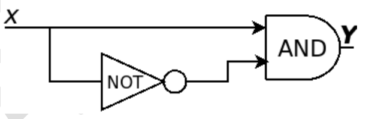

# 2024 CS1 Q28: Glitches in an AND gate fed by X and NOT X

## Question

Consider the circuit shown below where the gates may have propagation delays. Assume that all signal transitions occur instantaneously and that wires have no delays. Which of the following statements about the circuit is/are CORRECT?

- (A) With no propagation delays, the output $Y$ is always logic Zero
- (B) With no propagation delays, the output $Y$ is always logic One
- (C) With propagation delays, the output $Y$ can have a transient logic One after $X$ transitions from logic Zero to logic One
- (D) With propagation delays, the output $Y$ can have a transient logic Zero after $X$ transitions from logic One to logic Zero

Answer

**A and C**

Solution

The circuit computes $Y = X \cdot \overline{X}$.

**No delays.** $X \cdot \overline{X} = 0$ always. **(A) true, (B) false.**

**With a delay in the NOT gate**, the inverted input lags behind $X$ for a short time:

| Transition of $X$ | Direct input | NOT output (still old value) | AND output |
|---|---|---|---|
| $0 \to 1$ | 1 immediately | still 1 for a moment | **1 for a moment** (a glitch) |
| $1 \to 0$ | 0 immediately | still 0 for a moment | 0 (no glitch) |

- **(C) True.** On $0 \to 1$ both inputs are briefly 1, so $Y$ pulses to 1 (a static-0 hazard).
- **(D) False.** On $1 \to 0$ the direct input drops to 0 first, so the AND stays at 0. $Y$ never goes to a transient 0 because it was 0 already.

**Key idea:** a signal and its delayed inverse can both be 1 (or both 0) briefly. An AND of the two glitches high only on the rising edge.

