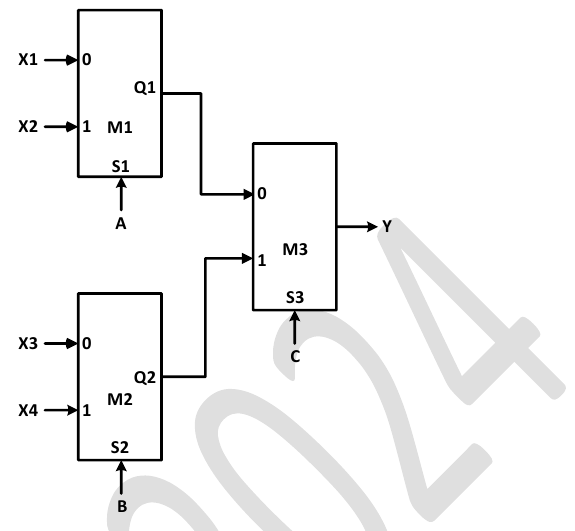

# 2024 CS1 Q64: Select-line combinations that give Y = 1

## Question

Consider a digital logic circuit consisting of three 2-to-1 multiplexers M1, M2, and M3 as shown below. X1 and X2 are inputs of M1. X3 and X4 are inputs of M2. A, B, and C are select lines of M1, M2, and M3, respectively.

For an instance of inputs X1=1, X2=1, X3=0, and X4=0, the number of combinations of A, B, C that give the output Y=1 is ________

Answer

**4**

Solution

**Evaluate the first stage.**

- M1 chooses between X1 and X2, which are both 1. So $Q_1 = 1$ whatever $A$ is.
- M2 chooses between X3 and X4, which are both 0. So $Q_2 = 0$ whatever $B$ is.

**Evaluate the last stage.** M3 outputs $Q_1$ when $C = 0$ and $Q_2$ when $C = 1$:

$$Y = \begin{cases} Q_1 = 1 & C = 0 \\ Q_2 = 0 & C = 1 \end{cases}$$

So $Y = 1$ exactly when $C = 0$. $A$ and $B$ are free (2 choices each):

$$2 \times 2 \times 1 = 4 \text{ combinations.}$$

**Key idea:** when both data inputs of a mux are equal, its select line does not matter.

