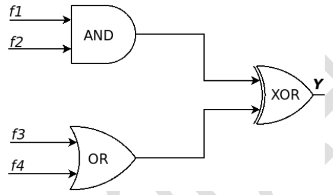

# 2024 CS2 Q50: Output of a circuit combining four minterm functions

## Question

Consider 4-variable functions $f_1, f_2, f_3, f_4$ expressed in sum-of-minterms form as given below.

$f_1 = \sum(0,2,3,5,7,8,11,13)$

$f_2 = \sum(1,3,5,7,11,13,15)$

$f_3 = \sum(0,1,4,11)$

$f_4 = \sum(0,2,6,13)$

With respect to the circuit given above, which of the following options is/are CORRECT?

- (A) $Y = \sum(0,1,2,11,13)$
- (B) $Y = \prod(3,4,5,6,7,8,9,10,12,14,15)$
- (C) $Y = \sum(0,1,2,3,4,5,6,7)$
- (D) $Y = \prod(8,9,10,11,12,13,14,15)$

Answer

**C and D**

Solution

The circuit computes $Y = (f_1 \cdot f_2) \oplus (f_3 + f_4)$. Work with minterm sets.

**AND** is the intersection: $f_1 \cdot f_2 = \lbrace 3,5,7,11,13 \rbrace$.

**OR** is the union: $f_3 + f_4 = \lbrace 0,1,2,4,6,11,13 \rbrace$.

**XOR** is the symmetric difference (in exactly one set):

- only in AND: $3, 5, 7$
- only in OR: $0, 1, 2, 4, 6$
- in both (cancel): $11, 13$

$$Y = \sum(0,1,2,3,4,5,6,7).$$

- **(C) True.**
- **(D) True.** $Y$ is 0 for $8$ to $15$, so $Y = \prod(8,9,\dots,15)$. It is the same function written with maxterms.
- **(A), (B) False.** (A) keeps 11 and 13, which cancel out. (B) lists the wrong zeros.

**Key idea:** AND = intersection, OR = union, XOR = symmetric difference of the minterm sets. A product of maxterms lists the zeros.

