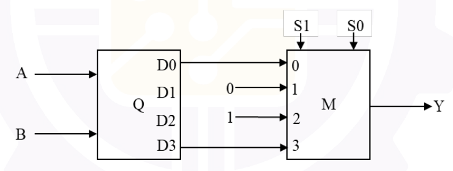

# 2026 CS2 Q59: Decoder feeding a 4-to-1 multiplexer

## Question

Consider the digital circuit shown below with two input lines $A$ and $B$, two select lines $S_0$ and $S_1$, and an output line $Y$. The blocks $Q$ and $M$ represent an active high 2:4 decoder and a 4-to-1 multiplexer, respectively. Out of 16 possible input combinations, the number of combinations that produce $Y = 1$ is ________. (answer in integer)

*Note:* one input combination is an instance of $[A\ B\ S_1\ S_0]$.

Answer

**6**

Solution

**Decoder Q (active high).** Exactly one output is 1, chosen by $AB$:

- $D0 = 1$ only when $AB = 00$
- $D3 = 1$ only when $AB = 11$

**Mux M.** It picks input number $S_1S_0$:

| $S_1S_0$ | Selected input | $Y$ | Inputs $AB$ giving $Y=1$ | Count |
|---|---|---|---|---|
| 00 | $D0$ | $D0$ | 00 | 1 |
| 01 | constant 0 | 0 | none | 0 |
| 10 | constant 1 | 1 | all four | 4 |
| 11 | $D3$ | $D3$ | 11 | 1 |

Total $= 1 + 0 + 4 + 1 = \mathbf{6}$ combinations out of 16.

**Sanity check:** it does not matter which of $A$, $B$ is the MSB of the decoder input. Only $AB = 00$ and $11$ are used, and both are symmetric. I also enumerated all 16 combinations by script and got 6.

**Key idea:** a decoder output is a single minterm of its inputs, and a mux just picks one of its data inputs by the select value.

