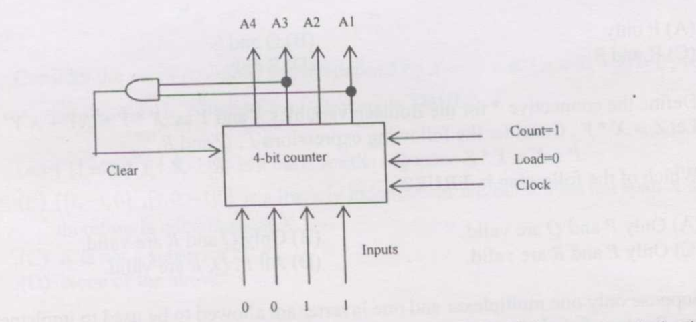

# 2007 CS Q36: Counter with asynchronous clear on A3 AND A1

## Question

The control signal functions of a 4-bit binary counter are given below (where X is "don't care"):

| Clear | Clock | Load | Count | Function |
|---|---|---|---|---|
| 1 | X | X | X | Clear to 0 |
| 0 | X | 0 | 0 | No change |
| 0 | ↑ | 1 | X | Load input |
| 0 | ↑ | 0 | 1 | Count next |

The counter is connected as follows:

Assume that the counter and gate delays are negligible. If the counter starts at 0, then it cycles through the following sequence:

- (A) 0, 3, 4
- (B) 0, 3, 4, 5
- (C) 0, 1, 2, 3, 4
- (D) 0, 1, 2, 3, 4, 5

Answer

**C**

Solution

Control inputs are tied to $Count = 1$ and $Load = 0$, so on each clock edge the counter does **Count next**. The data inputs $0011$ are never loaded (Load is never 1). That rules out (A) and (B), which show a jump to 3.

**Clear** is $A_3 \cdot A_1$, and the table shows Clear acts regardless of the clock (the "X" in the Clock column), so it is **asynchronous**. With $A_1$ as the LSB, $A_3 A_1 = 1$ first happens at $0101 = 5$.

Trace:

| Clock edge | Counter | Clear? |
|---|---|---|
| start | 0 | no |
| 1 | 1 | no |
| 2 | 2 | no |
| 3 | 3 | no |
| 4 | 4 | no |
| 5 | 5 (momentary) | $A_3A_1 = 1$, clears at once |
| | 0 | no |

With negligible delays, the count to 5 is wiped before it can be seen as a stable state. The stable sequence is $0, 1, 2, 3, 4, 0, \dots$: (C).

- (A) and (B) assume the preset value is loaded; Load is tied to 0.
- (D) treats Clear as synchronous (so 5 would be held for a clock). The table says Clear is asynchronous.

**Code check:** Python simulation of the counter with Count=1, Load=0 and asynchronous Clear $=A_3\wedge A_1$: the stable values repeat $0,1,2,3,4$; $5$ occurs only as a zero-width transient.

**Judgement call:** if you count the momentary state 5 as part of the sequence, (D) would be argued. With the stated negligible delays and an asynchronous Clear, (C) is the standard reading.

**Status note:** `unverified`. GATE 2007 had no official answer key, so there is nothing to compare against. This is my own answer.

**Key idea:** an asynchronous clear resets the counter as soon as the decoded value appears, so that value never becomes a stable state.

