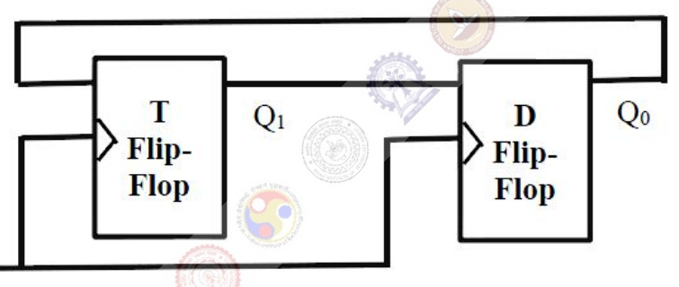

# 2017 CS1 Q33: Outputs of a T flip-flop and a D flip-flop connected in a loop

## Question

Consider a combination of T and D flip-flops connected as shown below. The output of the D flip-flop is connected to the input of the T flip-flop and the output of the T flip-flop is connected to the input of the D flip-flop.

Initially, both $Q_0$ and $Q_1$ are set to 1 (before the $1^{st}$ clock cycle). The outputs

- (A) $Q_1Q_0$ after the $3^{rd}$ cycle are 11 and after the $4^{th}$ cycle are 00 respectively
- (B) $Q_1Q_0$ after the $3^{rd}$ cycle are 11 and after the $4^{th}$ cycle are 01 respectively
- (C) $Q_1Q_0$ after the $3^{rd}$ cycle are 00 and after the $4^{th}$ cycle are 11 respectively
- (D) $Q_1Q_0$ after the $3^{rd}$ cycle are 01 and after the $4^{th}$ cycle are 01 respectively

Answer

**B**

Solution

**Next-state equations.** Both flip-flops share one clock, so they update together from the old values.

- T flip-flop toggles when $T=1$: $Q_1^{+} = Q_1 \oplus T$, and $T = Q_0$, so $Q_1^{+} = Q_1 \oplus Q_0$.
- D flip-flop copies its input: $Q_0^{+} = D = Q_1$.

**Trace from $Q_1Q_0 = 11$.**

| After cycle | $Q_1^{+} = Q_1\oplus Q_0$ | $Q_0^{+} = Q_1$ | $Q_1Q_0$ |
|---|---|---|---|
| 0 (initial) | | | 11 |
| 1 | $1\oplus1 = 0$ | 1 | 01 |
| 2 | $0\oplus1 = 1$ | 0 | 10 |
| 3 | $1\oplus0 = 1$ | 1 | **11** |
| 4 | $1\oplus1 = 0$ | 1 | **01** |

After the 3rd cycle: $11$; after the 4th: $01$. This is **(B)**. The sequence repeats with period 3: $11 \to 01 \to 10 \to 11$.

**Why the others fail.** (A) and (C) give $00$, a state this circuit never reaches from $11$. (D) has $01$ after cycle 3, but the 3rd-cycle state is $11$.

**Code check:** a simulation with simultaneous updates gave $01, 10, 11, 01$ for cycles 1 to 4.

**Key idea:** in a synchronous circuit, compute every next state from the old values at once, then update.

