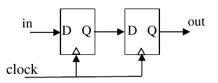

# 2018 CS Q32: States with a self-loop in a two-flip-flop circuit

## Question

Consider the sequential circuit shown in the figure, where both flip-flops used are positive edge-triggered D flip-flops.

The number of states in the state transition diagram of this circuit that have a transition back to the same state on some value of "in" is _____.

Answer

**2**

Solution

**It is a 2-bit shift register.** Let the state be $(Q_1, Q_2)$. On each clock edge:

$$Q_1^{+} = \text{in},\qquad Q_2^{+} = Q_1$$

**Self-loop condition:** the state stays the same only if $\text{in} = Q_1$ and $Q_1 = Q_2$.

| State $(Q_1Q_2)$ | Next state | Self-loop? |
|---|---|---|
| 00 | (in, 0) | yes, with in = 0 |
| 01 | (in, 0) | no: $Q_2$ becomes 0 |
| 10 | (in, 1) | no: $Q_2$ becomes 1 |
| 11 | (in, 1) | yes, with in = 1 |

Two states, **00 and 11**, loop back to themselves.

**Code check:** enumerating all four states and both inputs gave exactly the states 00 and 11.

**Key idea:** in a shift register the next state is "input then old Q1", so only states whose bits are equal can repeat.

