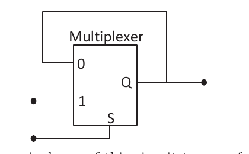

# 2023 CS Q21: 2-to-1 multiplexer with feedback

## Question

The output of a 2-input multiplexer is connected back to one of its inputs as shown in the figure.

Match the functional equivalence of this circuit to one of the following options.

- (A) D Flip-flop
- (B) D Latch
- (C) Half-adder
- (D) Demultiplexer

Answer

**B (D latch)**

Solution

**Write the output.** Input 1 is the external data $D$, input 0 is the output $Q$ itself, and $S$ is the select:

$$Q = S \cdot D + \overline{S} \cdot Q$$

- $S = 1$: $Q = D$. The output **follows** the input (transparent).
- $S = 0$: $Q = Q$. The output **holds** its value.

That is a **level-sensitive** storage element with $S$ as the enable: a **D latch**.

**Why the others fail:**
- **D flip-flop**: changes only on a clock *edge*, not while a level is held.
- **Half-adder**: combinational with two outputs (sum, carry). This circuit has memory.
- **Demultiplexer**: one input, many outputs, and no memory.

**Key idea:** a mux with its output fed back to one input stores a bit when it selects the feedback input.

