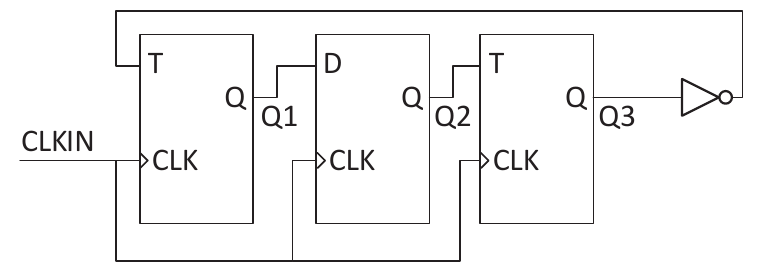

# 2023 CS Q43: T and D flip-flop chain: unreachable state

## Question

Consider a sequential digital circuit consisting of T flip-flops and D flip-flops as shown in the figure. CLKIN is the clock input to the circuit. At the beginning, Q1, Q2 and Q3 have values 0, 1 and 1, respectively.

Which one of the given values of (Q1, Q2, Q3) can NEVER be obtained with this digital circuit?

- (A) (0, 0, 1)
- (B) (1, 0, 0)
- (C) (1, 0, 1)
- (D) (1, 1, 1)

Answer

**A ((0, 0, 1))**

Solution

**Read the circuit.** All three flip-flops share CLKIN, so they change together. A T flip-flop toggles when T = 1. A D flip-flop copies D.

- FF1 (T): $T_1 = \overline{Q_3}$, so $Q_1^+ = Q_1 \oplus \overline{Q_3}$
- FF2 (D): $D_2 = Q_1$, so $Q_2^+ = Q_1$
- FF3 (T): $T_3 = Q_2$, so $Q_3^+ = Q_3 \oplus Q_2$

**Follow the states from (0, 1, 1):**

| Present $(Q_1Q_2Q_3)$ | Next |
|---|---|
| 011 | 000 |
| 000 | 100 |
| 100 | 010 |
| 010 | 101 |
| 101 | 111 |
| 111 | 110 |
| 110 | 011 |

The circuit cycles through 7 states: 011, 000, 100, 010, 101, 111, 110. The only state missing is **001**.

**Why 001 never appears.** Its only possible predecessor is 001 itself (it maps to itself), so it can be reached only if we start there.

**Code check:** a reachability search from 011 found every state except 001.

**Why the others fail:** (1,0,0), (1,0,1) and (1,1,1) all appear in the cycle.

**Key idea:** write the next-state equations and trace the state sequence from the given start.

