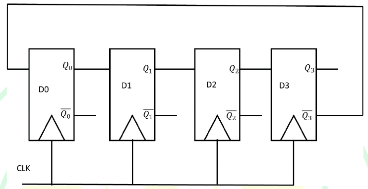

# 2025 CS1 Q60: States visited by a four-flip-flop twisted-ring circuit

## Question

Consider the given sequential circuit designed using D-Flip-flops. The circuit is initialized with some value (initial state). The number of distinct states the circuit will go through before returning back to the initial state is _________ . (Answer in integer)

Answer

**8**

Solution

Reading the wiring from the figure: $D_1 = Q_0$, $D_2 = Q_1$, $D_3 = Q_2$, and the feedback is $D_0 = \overline{Q_3}$. This is a **Johnson (twisted-ring) counter** with 4 flip-flops: the state shifts one place at each clock and the inverted last bit comes back in.

Starting from $Q_0Q_1Q_2Q_3 = 0000$:

| Clock | $Q_0 Q_1 Q_2 Q_3$ |
|---|---|
| start | 0000 |
| 1 | 1000 |
| 2 | 1100 |
| 3 | 1110 |
| 4 | 1111 |
| 5 | 0111 |
| 6 | 0011 |
| 7 | 0001 |
| 8 | 0000 (back to the start) |

The cycle contains $2n = 8$ distinct states for $n = 4$ flip-flops. The other $16 - 8 = 8$ states form a second, separate cycle (for example $0010 \to 1001 \to 0100 \to \dots$), which also has 8 states. So whichever state the circuit starts in, it visits 8 distinct states before returning.

The official key gives the range **7 to 8**. The count depends on whether the starting state is counted again when it returns. Counting the distinct states in the cycle gives **8**.

I simulated the circuit from 0000 and the cycle length came out as 8.

**Key idea:** an $n$-flip-flop Johnson counter has a cycle of $2n$ states.

