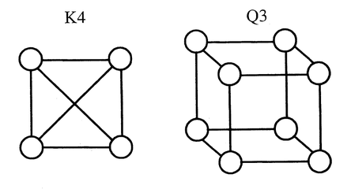

# 2011 CS Q17: Planarity of K4 and the cube graph Q3

## Question

K4 and Q3 are graphs with the following structures.

Which one of the following statements is **TRUE** in relation to these graphs?

- (A) K4 is planar while Q3 is not
- (B) Both K4 and Q3 are planar
- (C) Q3 is planar while K3 is not
- (D) Neither K4 nor Q3 is planar

*Printed as is: option (C) says K3, which looks like a typo for K4. It does not change the answer.*

Answer

**B**

Solution

- **K4** is planar. Draw three vertices as a triangle, put the fourth inside it and join it to all three corners. No edges cross. (The crossing diagonals in the figure are just one drawing.)
- **Q3** (the cube graph) is planar. Draw one square inside the other and join corresponding corners. No edges cross.

Euler's formula confirms Q3: $V - E + F = 8 - 12 + 6 = 2$ with the $6$ faces of the cube.

So both are planar: (B).

- (A), (D) claim Q3 is not planar, which is false.
- (C) K3 is a triangle, which is planar, so "K3 is not planar" is false (and the intended K4 is planar too).

**Code check:** a planarity test (`networkx.check_planarity`) returned planar for both $K_4$ and $Q_3$.

**Key idea:** K4 is the smallest complete graph that is still planar; the cube graph is planar because it is the skeleton of a polyhedron.

