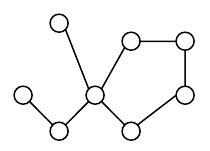

# 2012 CS Q26: Which graph is isomorphic to the given graph

## Question

Which of the following graphs is isomorphic to

- (A) the graph labelled A (top left)
- (B) the graph labelled B (top right)
- (C) the graph labelled C (bottom left)
- (D) the graph labelled D (bottom right)

Answer

**B**

Solution

Read the given graph by its structure. It has one centre vertex $c$ of degree $4$, and:

- a leaf (pendant vertex) attached to $c$;
- a path of two edges hanging from $c$;
- a **5-cycle** through $c$.

**Compare each option.**

| Option | Cycle through the centre | Centre degree | Matches? |
|---|---|---|---|
| A | triangle (3-cycle) | 4 | no, no 5-cycle |
| B | 5-cycle | 4 (leaf, path, 2 on cycle) | **yes** |
| C | 5-cycle, but the leaf is on a cycle vertex, not on the centre | 3 | no |
| D | 4-cycle | 4 | no, no 5-cycle |

Only B has the same cycle length, the same degree at the centre, and the leaf and the 2-path hanging from the centre. So (B).

**Code check:** I typed the edge lists read from the figure and tried every vertex relabelling ($8! = 40320$) against each option. Only B admitted an isomorphism. The edge lists come from reading the figure by eye.

**Key idea:** use invariants first (degree sequence, cycle lengths, where the leaf attaches) before trying to match vertices.

