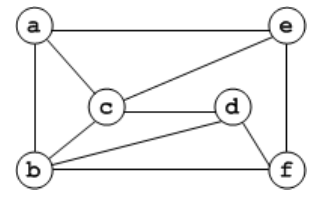

# 2018 CS Q28: Chromatic number of a six-vertex graph

## Question

The chromatic number of the following graph is _______.

Answer

**3**

Solution

**Edges read from the figure:** a-b, a-c, a-e, b-c, b-d, b-f, c-d, c-e, d-f, e-f.

**Lower bound.** $a, b, c$ are mutually adjacent (a triangle), so at least 3 colours are needed. There is no $K_4$ (the largest clique has 3 vertices), so nothing forces a fourth colour.

**A 3-colouring:**

| Vertex | a | b | c | d | e | f |
|---|---|---|---|---|---|---|
| Colour | 1 | 2 | 3 | 1 | 2 | 3 |

Check the tricky vertices: $d$ is adjacent to $b$ (2), $c$ (3), $f$ (3), so colour 1 is free. $e$ is adjacent to $a$ (1), $c$ (3), $f$ (3), so colour 2 is free. $f$ is adjacent to $b$ (2), $d$ (1), $e$ (2), so colour 3 is free.

The chromatic number is **3**.

**Code check:** a brute-force search over all colourings of the transcribed edge list found no 2-colouring and a valid 3-colouring.

**Key idea:** chromatic number is at least the largest clique; here a triangle exists, and a valid 3-colouring matches it.

