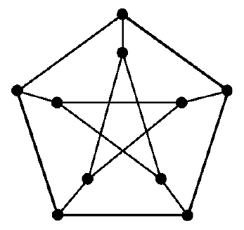

# 2022 CS Q50: The Petersen graph

## Question

The following simple undirected graph is referred to as the Petersen graph.

Which of the following statements is/are TRUE?

- (A) The chromatic number of the graph is 3.
- (B) The graph has a Hamiltonian path.
- (C) The following graph is isomorphic to the Petersen graph.

- (D) The size of the largest independent set of the given graph is 3. (A subset of vertices of a graph form an independent set if no two vertices of the subset are adjacent.)

Answer

**A, B and C**

Solution

**Labels.** Call the outer pentagon $o_0, \ldots, o_4$ (in cycle order) and the inner star vertices $i_0, \ldots, i_4$. The edges are the outer cycle, the spokes $o_k i_k$, and the star edges $i_k i_{k+2}$ (indices mod 5).

**(A) True.** The graph contains 5-cycles (odd), so it needs at least 3 colours, and a 3-colouring exists. Chromatic number $= 3$.

**(B) True.** The Petersen graph has no Hamiltonian cycle, but it does have a Hamiltonian path:

$$o_0, o_1, o_2, o_3, o_4, i_4, i_1, i_3, i_0, i_2$$

Consecutive vertices are joined by the outer cycle, the spoke $o_4 i_4$, and the star edges $i_4 i_1$, $i_1 i_3$, $i_3 i_0$, $i_0 i_2$.

**(C) True.** The second graph is 3-regular with 10 vertices and 15 edges. Its edges are: the 9-cycle around the ring, the three edges from the centre, the horizontal chord and the two diagonal chords. It is isomorphic to the Petersen graph.

**(D) False.** The largest independent set has size **4**, not 3. For example $\lbrace o_0, o_2, i_3, i_4 \rbrace$ has no two adjacent vertices. No set of 5 is independent.

**Code check:** using a graph library, the Petersen graph has chromatic number 3, has a Hamiltonian path (and no Hamiltonian cycle), and has independence number 4. The graph read from the second figure was checked to be isomorphic to it.

**Key idea:** know the standard Petersen facts: $\chi = 3$, Hamiltonian path but no Hamiltonian cycle, independence number 4.

**Figure note:** the edges of the graph in (C) were read from the picture (ring of 9, centre, horizontal chord and two diagonals) and the isomorphism check was run on that reading.

