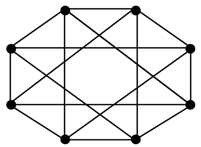

# 2024 CS2 Q60: Chromatic number of an 8-vertex graph

## Question

The chromatic number of a graph is the minimum number of colours used in a proper colouring of the graph. The chromatic number of the following graph is ________

Answer

**2**

Solution

**Read the graph.** Number the vertices $1$ to $8$ around the octagon, starting at the top-left. I read 16 edges from the figure, and every vertex has degree 4. (If an edge was misread the answer below could change.)

**Two groups.** Put the odd vertices $\lbrace 1,3,5,7 \rbrace$ in one group and the even vertices $\lbrace 2,4,6,8 \rbrace$ in the other. Every edge in the figure joins one odd vertex to one even vertex:

- Vertex 1 is joined to 2, 4, 6, 8.
- Vertex 3 is joined to 2, 4, 6, 8.
- Vertex 5 and vertex 7 likewise.

So the graph is $K_{4,4}$ (4 + 4 vertices, $4 \times 4 = 16$ edges, which matches the count).

**Chromatic number.** The graph has edges, so it needs at least 2 colours. It is bipartite, so 2 colours (one per group) suffice: **2**. A script also checked that no proper colouring with 1 colour exists and that 2 colours work.

**Key idea:** a graph is 2-colourable exactly when it is bipartite, i.e. it has no odd cycle.

