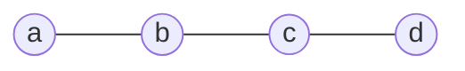
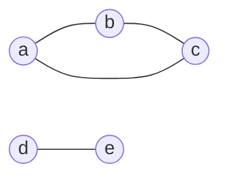

# 2026 CS1 Q47: Vertices forced into a minimum vertex cover

## Question

Let $G(V, E)$ be a simple, undirected graph. A *vertex cover* of $G$ is a subset $V' \subseteq V$ such that for every edge $(u, v) \in E$, $u \in V'$ or $v \in V'$. Let the size of the smallest vertex cover in $G$ be $k$, and let $S$ be any vertex cover of size $k$.

For a vertex $v \in V$, which of the following constraints will **always** ensure that $v \in S$?

- (A) The degree of $v$ is at least $k + 1$
- (B) The vertex $v$ is on a path of length $k + 1$
- (C) The vertex $v$ is on a cycle of length $k + 1$
- (D) The vertex $v$ is a part of a clique of size $k$

Answer

**A**

Solution

**(A) Always works.** Suppose $v \notin S$. Every edge at $v$ must still be covered, so every neighbour of $v$ must be in $S$. If $\deg(v) \ge k+1$, then $S$ has at least $k+1$ vertices. But $|S| = k$. Contradiction, so $v \in S$.

**The others each have a counterexample.** Here "length" means number of edges.

**(B) Path of length $k+1$.** Take the path $a - b - c - d$ (3 edges).

- Smallest cover: $k = 2$. For example $\lbrace b, c \rbrace$ works.
- Every vertex lies on the path itself, which has length $3 = k+1$.
- But $a \notin \lbrace b, c \rbrace$. So being on a path of length $k+1$ does not force $v \in S$.

**(C) Cycle of length $k+1$.** Take a triangle.

- Smallest cover: $k = 2$, for example $\lbrace a, b \rbrace$.
- Each vertex lies on the triangle, a cycle of length $3 = k+1$.
- But $c \notin \lbrace a, b \rbrace$.

**(D) Part of a clique of size $k$.** Take a triangle plus a separate edge $d - e$.

- Smallest cover: 2 for the triangle plus 1 for the edge, so $k = 3$.
- The triangle is a clique of size $3 = k$.
- The cover $\lbrace a, b, d \rbrace$ is a minimum cover and leaves out $c$.

**Verified.** I ran a brute force over 1500 random graphs: option A never failed. For B, C and D I listed all minimum covers of the three counterexample graphs above by brute force, and in each one some cover leaves out a vertex of the named path, cycle or clique.

**Key idea:** if $v$ is left out, all its neighbours must be in. So a vertex with more than $k$ neighbours cannot be left out of a cover of size $k$.

