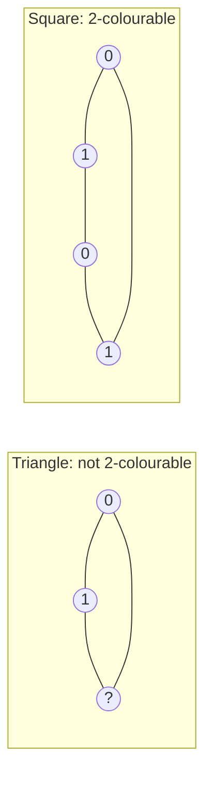

# 2026 CS1 Q55: Facts about 2-colourable graphs

## Question

An undirected, unweighted, simple graph $G(V, E)$ is *2-colourable* if there is a function $c: V \to \lbrace 0, 1 \rbrace$ such that for every $(u, v) \in E$, $c(u) \ne c(v)$.

Which of the following statements about 2-colourable graphs is/are true?

- (A) If $G$ is 2-colourable, then $G$ may contain cycles of odd length
- (B) If $G$ is 2-colourable, then $G$ may contain cycles of even length
- (C) An optimal algorithm for testing whether $G$ is 2-colourable runs in time $\Theta(|V| + |E|)$ if $G$ is represented as an adjacency list
- (D) An optimal algorithm for testing whether $G$ is 2-colourable runs in time $\Theta(|E| \log |V|)$ if $G$ is represented as an adjacency list

Answer

**B and C**

Solution

**Refresher.** A graph is 2-colourable exactly when it is **bipartite**: it has no cycle of odd length.

**(A) False.** In an odd cycle, colours must alternate around the cycle, but an odd number of steps ends on the opposite colour from where it started. So an odd cycle is never 2-colourable.

**(B) True.** Even cycles are fine, for example the square above is coloured 0, 1, 0, 1.

**(C) True.** Run BFS (or DFS) from each unvisited vertex. Give the start colour 0 and each neighbour the opposite colour. If an edge joins two vertices with the same colour, the graph is not 2-colourable. With adjacency lists this takes $\Theta(|V| + |E|)$. It cannot be faster, because any algorithm has to read the input.

**(D) False.** $\Theta(|E| \log |V|)$ is larger than $\Theta(|V| + |E|)$ in general, so it is not optimal.

**Verified.** I checked all graphs on up to 6 vertices (about 34,000 of them): a graph was 2-colourable if and only if it had no odd cycle.

**Key idea:** 2-colourable means bipartite means no odd cycle, and BFS colouring tests it in linear time.

