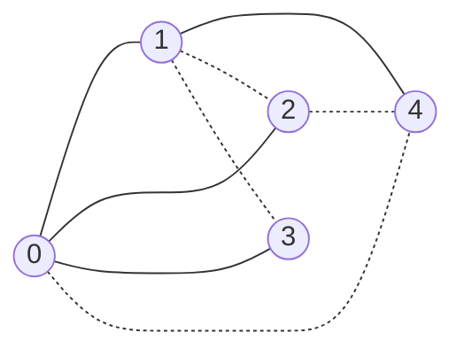

# 2026 CS2 Q36: Jaccard coefficient of spanning trees of K_n

## Question

Consider the complete graph $K_n$ with $n$ vertices ($n > 4$). Many spanning trees can be built on $K_n$. Each spanning tree is represented as a set of edges. The *Jaccard coefficient* between two sets is the size of their intersection divided by the size of their union.

Which option gives the **lowest possible** value of the Jaccard coefficient between any two spanning trees of $K_n$?

- (A) $\dfrac{1}{n}$
- (B) $\dfrac{1}{2n-3}$
- (C) $0$
- (D) $\dfrac{1}{n-1}$

Answer

**C**

Solution

**Idea.** The Jaccard value is

$$J(T_1, T_2) = \frac{|T_1 \cap T_2|}{|T_1 \cup T_2|}.$$

It can never be below 0, and it equals 0 exactly when the two trees share **no edge**. So the question is whether two edge-disjoint spanning trees exist in $K_n$.

**Counting check.** Each spanning tree has $n-1$ edges. Two disjoint trees need $2(n-1)$ edges, and $K_n$ has $\frac{n(n-1)}{2}$. For $n \ge 4$, $\frac{n(n-1)}{2} \ge 2(n-1)$, so there is room.

**Example for $n = 5$** (solid edges are $T_1$, dotted edges are $T_2$):

- $T_1 = \lbrace 01, 02, 03, 14 \rbrace$
- $T_2 = \lbrace 04, 12, 13, 24 \rbrace$

They have no common edge, so $J = 0/8 = 0$. The same works for $n = 6$ (found by search).

Since $J \ge 0$ always and $0$ is achieved, the lowest possible value is **0**.

**Why the others fail:** each of $\frac1n$, $\frac{1}{2n-3}$ and $\frac1{n-1}$ is greater than 0, so each would mean the two trees share at least one edge. But disjoint trees exist, so they are not the lowest. (For example, $\frac{1}{2n-3}$ is the value you get when two trees share exactly one edge, since the union then has $2(n-1)-1$ edges.)

**Verified.** I searched all spanning trees of $K_5$ and $K_6$ and found edge-disjoint pairs in both.

**Key idea:** "lowest possible" asks for the smallest value the formula can take, and 0 is reachable when disjoint trees exist.

