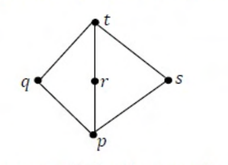

# 2015 CS1 Q42: Distributive law over the lattice with three middle elements

## Question

Suppose $\mathcal{L} = \lbrace p, q, r, s, t \rbrace$ is a lattice represented by the following Hasse diagram:

For any $x, y \in \mathcal{L}$, not necessarily distinct, $x \vee y$ and $x \wedge y$ are join and meet of $x, y$, respectively. Let $\mathcal{L}^3 = \lbrace (x, y, z) : x, y, z \in \mathcal{L} \rbrace$ be the set of all ordered triplets of the elements of $\mathcal{L}$. Let $p_r$ be the probability that an element $(x, y, z) \in \mathcal{L}^3$ chosen equiprobably satisfies $x \vee (y \wedge z) = (x \vee y) \wedge (x \vee z)$. Then

- (A) $p_r = 0$
- (B) $p_r = 1$
- (C) $0 < p_r \le \frac{1}{5}$
- (D) $\frac{1}{5} < p_r < 1$

Answer

**D**

Solution

This lattice is the diamond $M_3$: bottom $p$, top $t$, and three incomparable middle elements $q, r, s$. For two distinct middle elements, the meet is $p$ and the join is $t$.

It is **not distributive**, so the identity fails for some triples, but it holds for most.

**Failing triples.** Take $x, y, z$ to be three *different* middle elements, e.g. $(q, r, s)$:

- $x \vee (y \wedge z) = q \vee p = q$
- $(x\vee y) \wedge (x \vee z) = t \wedge t = t$

$q \ne t$, so it fails. There are $3! = 6$ such ordered triples.

**Everything else holds.** If any of $x,y,z$ is $p$ or $t$, or two of them are equal, the identity holds (checked by cases).

$$p_r = \frac{125 - 6}{125} = \frac{119}{125} = 0.952$$

So $\frac15 < p_r < 1$: option (D). (A) and (C) are far too small. (B) would need a distributive lattice.

**Code check:** a brute-force script over all $5^3 = 125$ triples found exactly 119 that satisfy the identity.

**Key idea:** $M_3$ is the smallest non-distributive modular lattice; distributivity fails only on triples of three distinct atoms.

