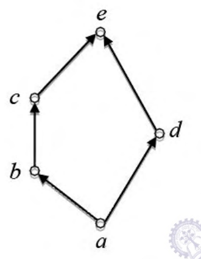

# 2017 CS2 Q21: Pairs to add to make a given poset a lattice

## Question

Consider the set $X = \lbrace a, b, c, d, e \rbrace$ under the partial ordering

$$R = \lbrace (a,a), (a,b), (a,c), (a,d), (a,e), (b,b), (b,c), (b,e), (c,c), (c,e), (d,d), (d,e), (e,e) \rbrace.$$

The Hasse diagram of the partial order $(X, R)$ is shown below.

The minimum number of ordered pairs that need to be added to $R$ to make $(X, R)$ a lattice is ______.

Answer

**0**

Solution

**Lattice test.** A poset is a lattice if **every pair** of elements has a least upper bound (join) and a greatest lower bound (meet).

**Order from the diagram:** $a < b < c < e$ and $a < d < e$.

- **Comparable pairs** (one below the other) are fine: their join is the larger element and their meet is the smaller one.
- The only **incomparable** pairs are $(b, d)$ and $(c, d)$.

| Pair | Upper bounds | Join | Lower bounds | Meet |
|---|---|---|---|---|
| $b, d$ | $e$ | $e$ | $a$ | $a$ |
| $c, d$ | $e$ | $e$ | $a$ | $a$ |

Both have a unique join and a unique meet, so $(X,R)$ is **already a lattice**. No pair has to be added: **0**.

(The key accepts the range $-0.01$ to $0.01$, i.e. 0.)

**Code check:** a program built the order from $R$, checked it is reflexive, antisymmetric and transitive, then found a unique lub and glb for all 25 ordered pairs of elements. No pair lacked one.

**Key idea:** a poset with a top ($e$) and a bottom ($a$) is not automatically a lattice, so check joins and meets for every incomparable pair.

