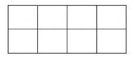

# 2016 CS2 Q64: Number of rectangles in a 2 by 4 grid

## Question

(GA Set-6, Q9) In a $2 \times 4$ rectangle grid shown below, each cell is a rectangle. How many rectangles can be observed in the grid?

- (A) 21
- (B) 27
- (C) 30
- (D) 36

Answer

**C**

Solution

A rectangle is fixed by choosing **two horizontal grid lines** and **two vertical grid lines**.

- The grid has $2 + 1 = 3$ horizontal lines: $\binom{3}{2} = 3$ choices.
- It has $4 + 1 = 5$ vertical lines: $\binom{5}{2} = 10$ choices.

$$3 \times 10 = 30$$

**(C)**.

**Key idea:** $\binom{3}{2} \times \binom{5}{2} = 3 \times 10 = 30$.

