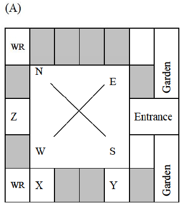
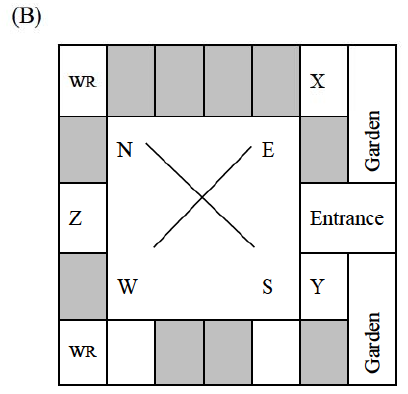
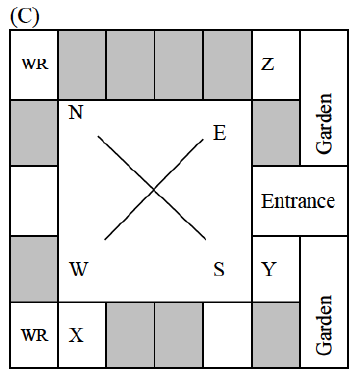
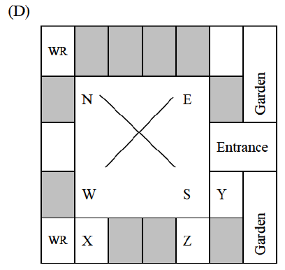

# 2019 CS2 Q10: Choose the hostel plan that fits three requests

## Question

Three of the five students allocated to a hostel put in special requests to the warden. Given the floor plan of the vacant rooms, select the allocation plan that will accommodate all their requests.

- Request by X: Due to pollen allergy, I want to avoid a wing next to the garden.
- Request by Y: I want to live as far from the washrooms as possible, since I am very sensitive to smell.
- Request by Z: I believe in Vaastu and so want to stay in the South-west wing.

The shaded rooms are already occupied. WR is washroom.

**(A)**

**(B)**

**(C)**

**(D)**

Answer

**D**

Solution

**How to read the plan.** The letters N, E, S, W sit at the **corners** of the central court (N top-left, E top-right, S bottom-right, W bottom-left). So the wings run along the sides:

| Wing | Side of the building |
|---|---|
| North-east | top row |
| South-east | right side (the garden side) |
| South-west | bottom row |
| North-west | left side |

The two washrooms are the top-left and bottom-left corner rooms.

**Test each plan:**

| Plan | Z in South-west (bottom row)? | X away from garden wing? | Verdict |
|---|---|---|---|
| A | No, Z is on the left side | n/a | Fails |
| B | No, Z is on the left side | No, X is next to the garden | Fails |
| C | No, Z is in the top-right corner | n/a | Fails |
| **D** | **Yes** | **Yes**, X is in the bottom row | **Passes** |

**Plan D in full:** Z is in the bottom row (South-west wing). X is in the bottom row too, not on the garden side. Y is on the right side, far from both washrooms on the left.

**Key idea:** work out which wing each person is in from the figure's own compass labels, then test every request.

