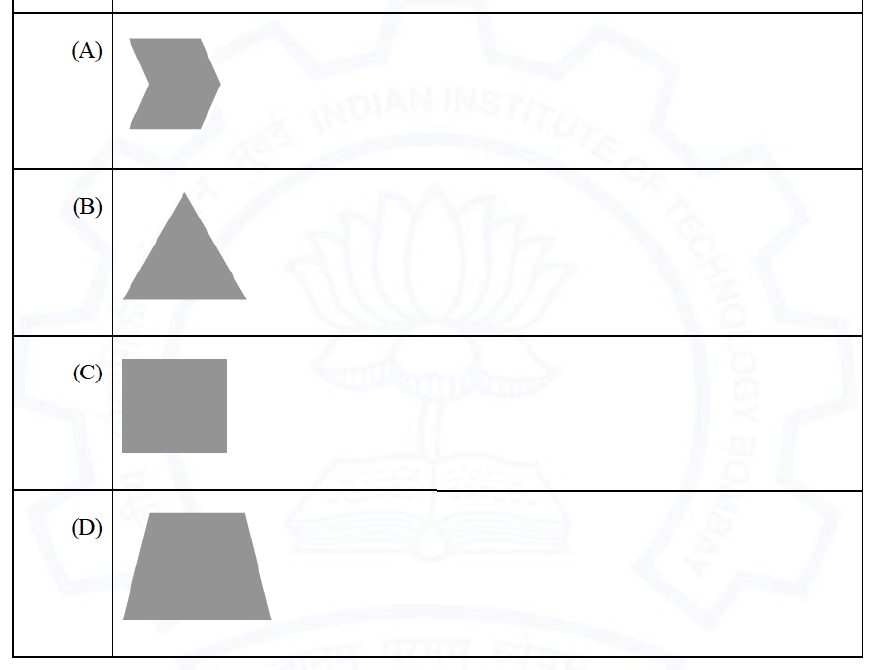

# 2021 CS1 Q2: The shape that is not a convex polygon

## Question

A polygon is convex if, for every pair of points P and Q belonging to the polygon, the line segment PQ lies completely inside or on the polygon.

Which one of the following is NOT a convex polygon?

Answer

**A**

Solution

A polygon is non-convex exactly when it has an interior angle greater than $180^\circ$ (a "dent").

- (A) The chevron has a notch on its left side. Take one point on each prong of the notch. The segment joining them passes outside the shape. **Not convex.**
- (B) A triangle is always convex.
- (C) A square is convex.
- (D) A trapezium has all interior angles below $180^\circ$. Convex.

**Key idea:** a reflex (inward-pointing) vertex makes a polygon non-convex.

