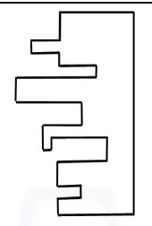
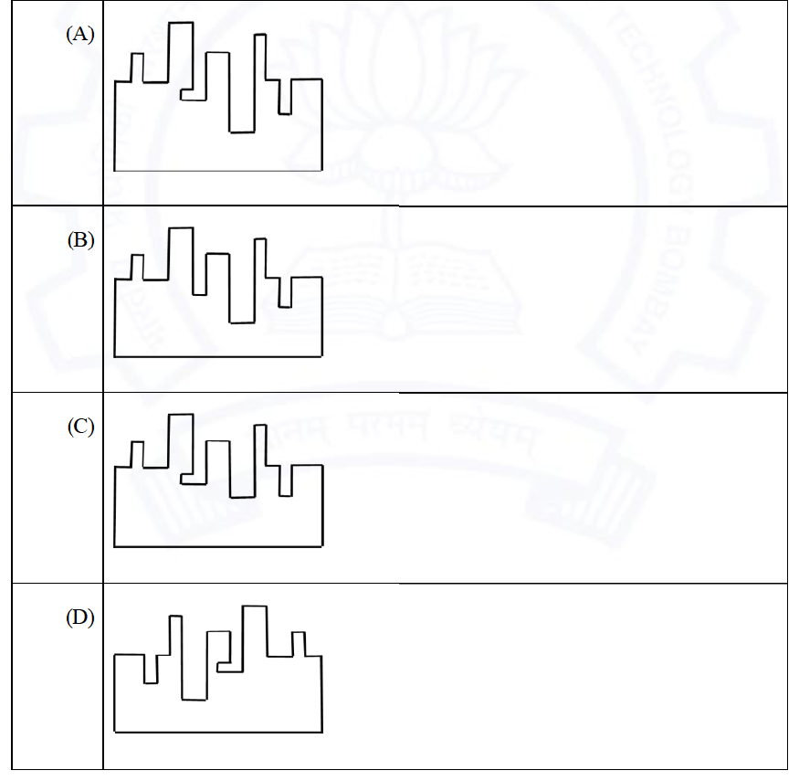

# 2021 CS2 Q7: Missing piece of a two-piece jigsaw rectangle

## Question

A jigsaw puzzle has 2 pieces. One of the pieces is shown above. Which one of the given options for the missing piece when assembled will form a rectangle? The piece can be moved, rotated or flipped to assemble with the above piece.

Answer

**A**

Solution

**Status: unverified.** The official key is **A**. I could not confirm it from the figure.

**Method.** The piece has a straight edge on the right and a toothed edge on the left. The missing piece must have a straight outer edge and a toothed edge whose teeth fill the notches of the given piece exactly, with its notches taking the given piece's teeth. The two toothed edges must be mirror profiles of each other, and the combined thickness must be constant.

**What I tried.** I traced both shapes into pixel masks, tried all 8 rotations and flips of each option, and looked for the placement where the pieces overlap least and leave no gaps. I also compared the thickness profile of the given piece with each option's profile. The mismatch scores were close for all four options (about 1,750 to 2,500 pixels, and the best orientation scored around 16 to 18 in standard deviation of the thickness sum), and option A did not stand out. The drawings are not at a common scale and the lines are thick, so this check could not separate them.

I am recording the key's answer (A) and leaving the status as unverified, rather than claiming I proved it.

**Key idea:** in a two-piece jigsaw, the toothed edges must be exact mirror images, so each tooth of one piece sits in a notch of the other.

