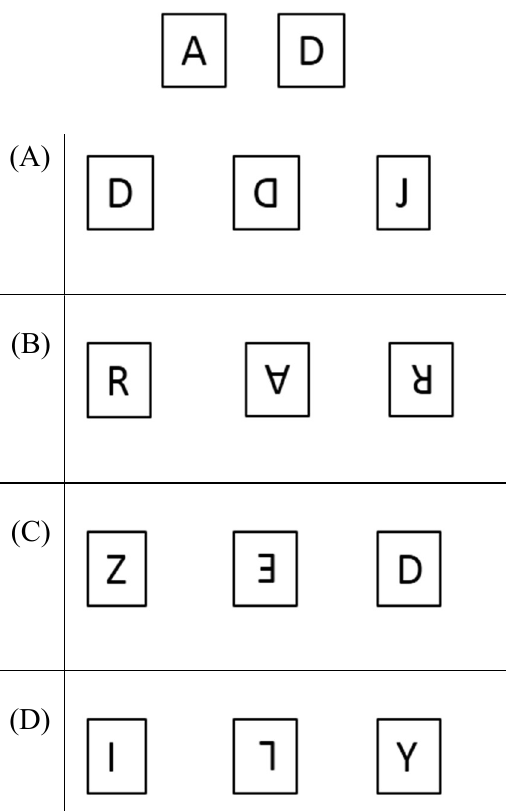

# 2022 CS Q5: Five plates forming a palindrome

## Question

A palindrome is a word that reads the same forwards and backwards. In a game of words, a player has the following two plates painted with letters: **A** and **D**.

From the additional plates given in the options, which one of the combinations of additional plates would allow the player to construct a five-letter palindrome? The player should use all the five plates exactly once. The plates can be rotated in their plane.

- (A) D, rotated D, J
- (B) R, rotated A, rotated R
- (C) Z, rotated E, D
- (D) I, rotated L, Y

Answer

**B (R, rotated A, rotated R)**

Solution

**Read the plates in their rotated form.** A plate turned 180° shows the original letter once turned back. In option B the second plate is A turned upside down, and the third is R turned 180° (stem on the right, bowl at the bottom left), not a mirror image.

So option B supplies the letters R, A, R. With the given A and D, the five letters are A, A, D, R, R. They form

$$\text{R A D A R}$$

which reads the same both ways.

**Why the others fail:**
- (A) letters A, D, D, D, J: J cannot pair with anything.
- (C) letters A, D, Z, E, D: Z and E each appear once, so no palindrome.
- (D) letters A, D, I, L, Y: every letter appears once, so no palindrome.

**Key idea:** a five-letter palindrome needs two matching pairs plus a middle letter, so exactly one letter may appear an odd number of times.

**Figure note:** the third plate of option B is a 180° rotation of R, not a reflection. This was checked at 600 dpi.

