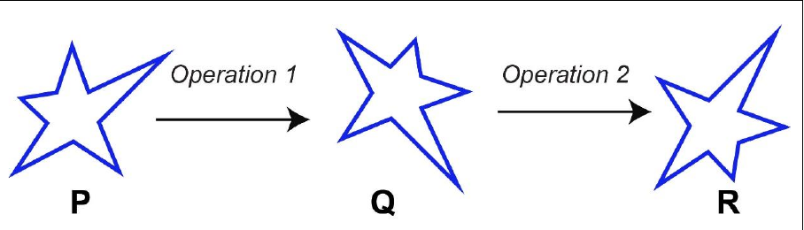

# 2023 CS Q10: Rotation then reflection of a star

## Question

Which one of the options best describes the transformation of the 2-dimensional figure P to Q, and then to R, as shown?

- (A) **Operation 1:** A clockwise rotation by 90° about an axis perpendicular to the plane of the figure. **Operation 2:** A reflection along a horizontal line
- (B) **Operation 1:** A counter clockwise rotation by 90° about an axis perpendicular to the plane of the figure. **Operation 2:** A reflection along a horizontal line
- (C) **Operation 1:** A clockwise rotation by 90° about an axis perpendicular to the plane of the figure. **Operation 2:** A reflection along a vertical line
- (D) **Operation 1:** A counter clockwise rotation by 180° about an axis perpendicular to the plane of the figure. **Operation 2:** A reflection along a vertical line

Answer

**A**

Solution

**Track the long spike of the star.**

**Operation 1 (P to Q).** In P the long spike points to the upper right. In Q it points down and to the right. The star is not mirrored, only turned. Going from "up-right" to "down-right" is a **clockwise rotation of about 90°**. That rules out B and D.

**Operation 2 (Q to R).** The long spike stays on the right side but flips from pointing down to pointing up. Top and bottom are swapped while left and right stay put. That is a **reflection about a horizontal line**. A reflection about a vertical line would move the spike to the left side, so C is wrong.

**Key idea:** rotation keeps the figure's handedness. A reflection reverses it, and the mirror line is the one the figure is *not* swapped across.

