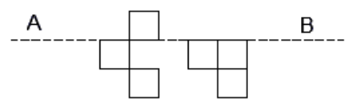

# 2024 CS1 Q10: Squares to add to make AB a line of symmetry

## Question

The least number of squares to be added in the figure to make AB a line of symmetry is

- (A) 6
- (B) 4
- (C) 5
- (D) 7

Answer

**A (6) per the key, but see the note**

Solution

**Status: disputed.** The key gives **A (6)**. My count from the figure is **5**.

**Set up a grid.** Take AB as a horizontal mirror. Rows below the line are $+1, +2$ and rows above are $-1, -2$. Columns are 1 to 5 (column 3 is the empty gap).

| Row | Columns with a square |
|---|---|
| $-1$ (above) | 2 |
| $+1$ (below) | 1, 2, 4, 5 |
| $+2$ (below) | 2, 5 |

**Mirror each square across AB.**

- The one square above, at (row $-1$, col 2), mirrors to (row $+1$, col 2). That square is already there.
- The six squares below need mirror partners at (rows $-1,-2$): cols 1, 2, 4, 5 in row $-1$ and cols 2, 5 in row $-2$. Only (row $-1$, col 2) exists.

Missing above: (row $-1$: cols 1, 4, 5) and (row $-2$: cols 2, 5) = **5 squares**. Nothing needs adding below.

**Why I am flagging it.** I could not find a reading of this figure that needs 6. The key I used comes from a non-official mirror (the IISc site had no 2024 PDFs when I looked), so the key or my reading of the printed figure may be off. I have not changed the answer to fit either side.

**Key idea:** for a line of symmetry, every square needs a mirror partner. Count the squares that lack one.

