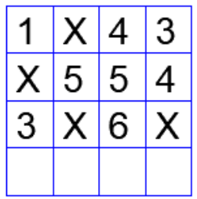

# 2024 CS2 Q10: Minesweeper-style grid, sum of the last row

## Question

In the $4 \times 4$ array shown below, each cell of the first three rows has either a cross (X) or a number.

The number in a cell represents the count of the immediate neighboring cells (left, right, top, bottom, diagonals) NOT having a cross (X). Given that the last row has no crosses (X), the sum of the four numbers to be filled in the last row is

- (A) 11
- (B) 10
- (C) 12
- (D) 9

Answer

**A (11)**

Solution

**Crosses** are at (row, col): (1,2), (2,1), (3,2), (3,4). The last row has none.

**Check the layout.** For example the "6" at (3,3) has 8 neighbours, 2 of them crosses, so 6 ✓. The "1" at (1,1) has neighbours (1,2)=X, (2,1)=X, (2,2)=number, so 1 ✓.

**Last row.** Count neighbours that are not crosses:

| Cell | Neighbours | Crosses | Number |
|---|---|---|---|
| (4,1) | 3 | (3,2) | **2** |
| (4,2) | 5 | (3,2) | **4** |
| (4,3) | 5 | (3,2), (3,4) | **3** |
| (4,4) | 3 | (3,4) | **2** |

Sum $= 2 + 4 + 3 + 2 = 11$.

**Key idea:** count only neighbours that exist and are not crosses. Edge and corner cells have fewer neighbours.

