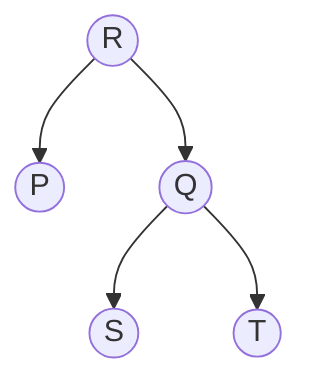

# 2025 CS1 Q4: Family relationships among P, Q, R, S and T

## Question

Consider the relationships among P, Q, R, S, and T:

- P is the brother of Q.
- S is the daughter of Q.
- T is the sister of S.
- R is the mother of Q.

The following statements are made based on the relationships given above.

1. R is the grandmother of S.
2. P is the uncle of S and T.
3. R has only one son.
4. Q has only one daughter.

Which one of the following options is correct?

- (A) Both (1) and (2) are true.
- (B) Both (1) and (3) are true.
- (C) Only (3) is true.
- (D) Only (4) is true.

Answer

**A**

Solution

Build the family tree.

*R is the mother of P and Q. S and T are sisters, and S is Q's daughter, so T is also Q's child.*

| Statement | Verdict | Reason |
|---|---|---|
| 1. R is the grandmother of S | **True** | R is Q's mother and S is Q's daughter |
| 2. P is the uncle of S and T | **True** | P is Q's brother, and S, T are Q's daughters |
| 3. R has only one son | Not certain | P is a son (he is a brother). Q's gender is not given, so Q could also be a son |
| 4. Q has only one daughter | **False** | S and T are sisters, so both are Q's daughters |

Only (1) and (2) are definitely true: option A.

**Key idea:** put every given relation on a tree, and accept only what the tree forces. Do not assume unstated genders.

