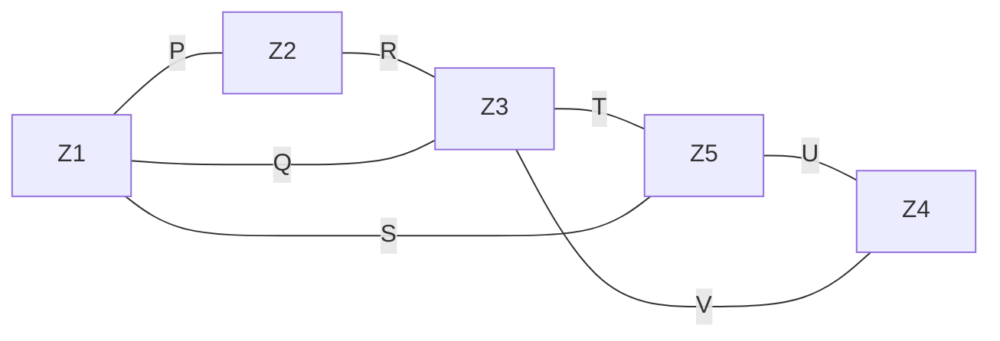

# 2025 CS2 Q10: Fewest bridges to connect five zones

## Question

The diagram below shows a river system consisting of 7 segments, marked P, Q, R, S, T, U, and V. It splits the land into 5 zones, marked Z1, Z2, Z3, Z4, and Z5. We need to connect these zones using the least number of bridges. Out of the following options, which one is correct?

Note: The figure shown is representative.

- (A) Bridges on P, Q, and T
- (B) Bridges on P, Q, S, and T
- (C) Bridges on Q, R, T, and V
- (D) Bridges on P, Q, S, U, and V

Answer

**C**

Solution

Treat each zone as a vertex and each river segment as an edge between the two zones it separates.

| Segment | Zones it separates |
|---|---|
| P | Z1 and Z2 |
| R | Z2 and Z3 |
| Q | Z1 and Z3 |
| T | Z3 and Z5 |
| S | Z1 and Z5 |
| U | Z5 and Z4 |
| V | Z3 and Z4 |

To connect 5 zones you need at least 4 bridges, which means a spanning tree.

| Option | Bridges | Connects all five? |
|---|---|---|
| A: P, Q, T | 3 | No: Z4 is left out (and 3 bridges cannot join 5 zones) |
| B: P, Q, S, T | 4 | No: Z4 is not touched by P, Q, S or T |
| **C: Q, R, T, V** | 4 | **Yes**: Z1-Z3, Z2-Z3, Z3-Z5, Z3-Z4 join all five |
| D: P, Q, S, U, V | 5 | Connects all, but a cycle Z1-Z3-Z4-Z5 makes one bridge redundant, so it is not the least |

**Key idea:** the fewest bridges is a spanning tree: $n - 1 = 4$ edges for 5 zones.

