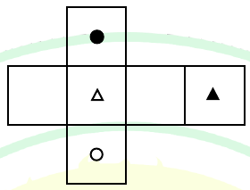

# 2025 CS2 Q4: Which cube does the net make

## Question

The paper as shown in the figure is folded to make a cube where each square corresponds to a particular face of the cube. Which one of the following options correctly represents the cube?

Note: The figures shown are representative.

Answer

**A**

Solution

Fold the cross-shaped net with the **open-triangle square as the front face**.

| Face | Square in the net |
|---|---|
| Front | open triangle |
| Top | filled circle (the square above the front) |
| Bottom | open circle (the square below the front) |
| Left | blank (the square to the left) |
| Right | blank (the square to the right) |
| Back | filled triangle (the far-right square, folded round) |

In every option the front face is the open triangle, and the visible top and right faces are what differ.

| Option | Top shown | Right shown | Verdict |
|---|---|---|---|
| **A** | filled circle | blank | **matches** |
| B | blank | filled triangle | Right face should be blank. The filled triangle is the **back** face |
| C | blank | blank | Top should be the filled circle |
| D | filled triangle | filled circle | Both wrong: the filled triangle is the back, and the filled circle is the top |

**Key idea:** fix one face as the front, read off its four neighbours from the net, and remember the face that is two squares away in the row becomes the opposite face.

