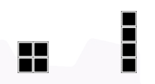
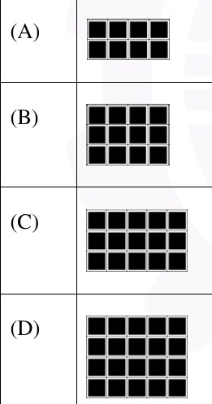

# 2026 CS1 Q2: Which pattern cannot be built from 4-tile pieces

## Question

The figure shows two 4-tile patterns.

Either one or both of the patterns can be used any number of times and in any orientation to construct a new pattern. Which one of the options below **cannot** be constructed by using only these two 4-tile patterns assuming there are no overlaps among them?

- (A) A solid 4 × 2 block (8 tiles)
- (B) A solid 4 × 3 block (12 tiles)
- (C) A solid 5 × 3 block (15 tiles)
- (D) A solid 5 × 4 block (20 tiles)

Answer

**C**

Solution

**Count the tiles.** Both patterns have exactly 4 tiles. So any pattern built only from them has a number of tiles that is a **multiple of 4**.

| Option | Size | Tiles | Multiple of 4? | How to build it |
|---|---|---|---|---|
| (A) | 4 × 2 | 8 | yes | two 2 × 2 squares, or two horizontal bars |
| (B) | 4 × 3 | 12 | yes | three horizontal bars of 4 |
| (C) | 5 × 3 | **15** | **no** | impossible |
| (D) | 5 × 4 | 20 | yes | five vertical bars of 4 |

Option (C) has 15 tiles, and 15 is not divisible by 4, so no combination of 4-tile pieces can fill it.

**Key idea:** a quick counting (divisibility) test can rule out a tiling without trying every arrangement.

