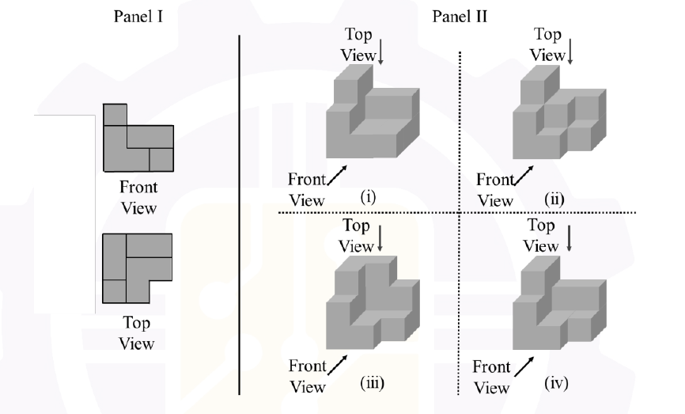

# 2026 CS1 Q7: Matching front and top views to a 3D structure

## Question

In Panel I of the figure below, the front view and top view of a structure are shown. Which one of the 3D structures shown in Panel II possesses the views shown in Panel I?

- (A) (i)
- (B) (ii)
- (C) (iii)
- (D) (iv)

Answer

**(iv)**

Solution

**What the two views tell us**

- **Front view** (3 columns wide): the left column is 3 blocks high, and the middle and right columns are 2 blocks high.
- **Top view** (3 × 3 outline): the footprint is an L. The corner at the **front right** is empty. The other 8 cells are filled.

**How to test an option:** look at the structure from the front and check that its outline is 3, 2, 2 blocks high from left to right. Then look from above and check that the front-right corner is empty and the rest is filled. The right option must pass both tests.

**Answer.** The official key gives **(iv)**.

**Flag:** I could not reliably match the isometric drawings to the views by script, so I have *not* independently verified this answer. It follows the official key, and this question is marked `unverified`.

**Key idea:** combine the front silhouette (heights) with the top outline (footprint) to rebuild the solid.

