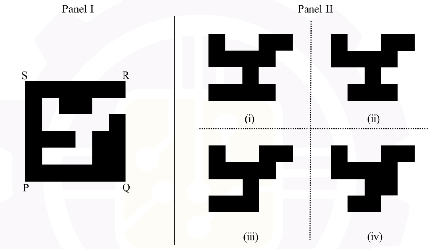

# 2026 CS2 Q2: The other part of a cut square

## Question

A black square PQRS has been cut into two parts. One part of it is shown in Panel I. Which one of the shapes in Panel II is the other part?



- (A) (i)
- (B) (ii)
- (C) (iii)
- (D) (iv)

<details class="success" markdown="1">
<summary>Answer</summary>

**(iii)**

</details>

<details class="info" markdown="1">
<summary>Solution</summary>

**Idea.** The two parts together make a solid square. So the missing part is exactly the *white space* inside the square in Panel I.

**Method.** I measured the picture on a 6 × 6 grid of cells. Panel I is black on the border and in a few inner cells (1 = black):

```
1 1 1 1 1 1
1 0 1 1 0 0
1 0 0 0 0 1
1 1 1 0 1 1
1 0 0 0 1 1
1 1 1 1 1 1
```

The white cells (the other part) therefore form this shape inside the grid (inner 4 rows by 5 columns):

```
. . . . . .
. # . . # #
. # # # # .
. . . # . .
. # # # . .
. . . . . .
```

Cut out the shape and compare it with the options (4 rows by 5 columns):

```
(iii)   # . . # #
        # # # # .
        . . # . .
        # # # . .
```

This matches **(iii)** exactly, with no rotation needed. The others differ in the bottom two rows:

- (i) has `1 1 1 1 .` in the last row (one cell too many).
- (ii) has `. 1 1 1 .` in the last row.
- (iv) has `. . 1 1 .` and `. 1 1 . .` in the last two rows.

**Key idea:** if two pieces make a full square, one piece is the complement (the holes) of the other.

</details>
