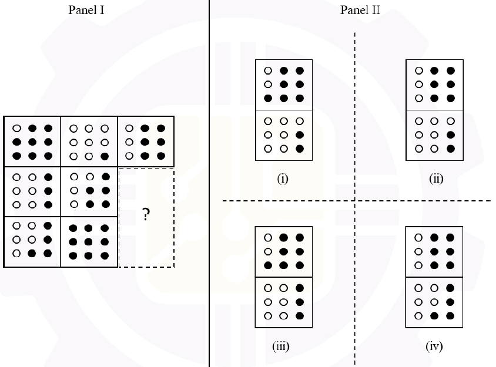

# 2026 CS2 Q7: Missing tiles in a dot-pattern grid

## Question

Two tiles are missing in Panel I. Which one of the options in Panel II is the appropriate choice for the missing tiles?

- (A) (i)
- (B) (ii)
- (C) (iii)
- (D) (iv)

Answer

**(i)**

Solution

**Count the filled dots in each tile.**

| | Col 1 | Col 2 | Col 3 |
|---|---|---|---|
| Row 1 | 8 | 1 | 6 |
| Row 2 | 3 | 5 | **?** |
| Row 3 | 4 | 9 | **?** |

This is the **Lo Shu magic square**: every row, column and diagonal sums to 15.

- Row 2: $3 + 5 + ? = 15$, so the tile is **7**.
- Row 3: $4 + 9 + ? = 15$, so the tile is **2**.
- Check the last column: $6 + 7 + 2 = 15$.

**How the dots show a number $n$.** The dots fill in a fixed order: the right column from bottom to top, then the middle column from bottom to top, then the left column from bottom to top. For example, 3 = the whole right column, 5 = right column + the bottom two of the middle column.

- **7** = right column, middle column, and the bottom dot of the left column. That is `○●● / ○●● / ●●●`.
- **2** = bottom two dots of the right column. That is `○○○ / ○○● / ○○●`.

Option (i) shows exactly these two tiles (7 on top, 2 below).

**Why the others fail:**

- (ii) top tile has 6 dots, not 7.
- (iii) bottom tile has 3 dots, not 2.
- (iv) top tile has 6 and bottom has 4.

**Key idea:** turn the pictures into numbers; the numbers form a magic square.

