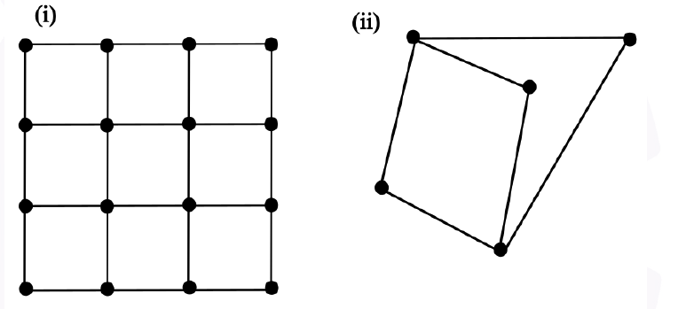

# 2026 CS2 Q8: Round trip through every city (Hamiltonian cycle)

## Question

Figures (i) and (ii) represent intercity highway systems. The black dots represent cities and the line segments between them represent intercity highways. A salesperson needs to make a trip. She needs to start from a city, visit each of the remaining cities exactly once, and finally return to the same city from which she started.

Which one of the following options is then true?

- (A) Such a trip is possible for (i), but not for (ii).
- (B) Such a trip is possible for (ii), but not for (i).
- (C) Such a trip is possible for both (i) and (ii).
- (D) Such a trip is possible neither for (i) nor for (ii).

Answer

**A**

Solution

The trip asked for is a **Hamiltonian cycle**: visit every vertex exactly once and return to the start.

**Figure (i): 4 × 4 grid.** A cycle exists. Number cities by (row, column):

(1,1) → (1,2) → (1,3) → (1,4) → (2,4) → (3,4) → (4,4) → (4,3) → (3,3) → (2,3) → (2,2) → (3,2) → (4,2) → (4,1) → (3,1) → (2,1) → back to (1,1).

All 16 cities appear once, and each step is along a road. **Possible.**

**Figure (ii): 5 cities.** Call the two cities with three roads $A$ and $E$, and the other three $B$, $C$, $D$. Each of $B$, $C$, $D$ is joined only to $A$ and $E$. This graph is $K_{2,3}$.

- A cycle must alternate between the groups $\lbrace A, E \rbrace$ and $\lbrace B, C, D \rbrace$.
- That needs the two groups to have the **same size**. Here they are 2 and 3.
- So no cycle through all 5 cities exists. **Not possible.** (I also checked all orderings by script.)

So the trip is possible for (i) but not (ii): option (A).

**Key idea:** a bipartite graph with unequal sides has no Hamiltonian cycle.

