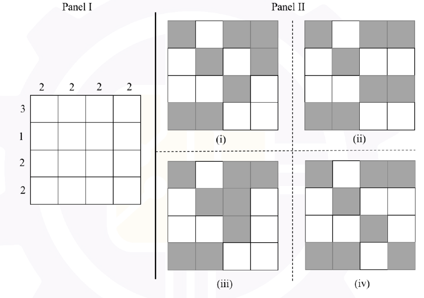

# 2026 CS2 Q9: Shading a grid to meet row and column counts

## Question

The figure in Panel I below is a grid of cells with four rows and four columns. The numbers on the top and on the left represent the number of cells that are to be shaded in that column and row, respectively. Which one of the options shown in Panel II below represents the grid shaded correctly?



- (A) (i)
- (B) (ii)
- (C) (iii)
- (D) (iv)

<details class="success" markdown="1">
<summary>Answer</summary>

**(ii)**

</details>

<details class="info" markdown="1">
<summary>Solution</summary>

**Targets:** rows need 3, 1, 2, 2 shaded cells (top to bottom). Columns need 2, 2, 2, 2.

Count the shaded cells in each option (`1` = shaded):

| Option | Row counts | Matches 3, 1, 2, 2? |
|---|---|---|
| (i) | 3, **2**, 1, 2 | no, row 2 has 2 |
| **(ii)** | 3, 1, 2, 2 | **yes** |
| (iii) | 3, **2**, 1, 2 | no, row 2 has 2 |
| (iv) | 3, 1, **1**, **3** | no, rows 3 and 4 are off |

Option (ii) also has 2 shaded cells in each column.

```
1 0 1 1   -> 3
0 1 0 0   -> 1
0 0 1 1   -> 2
1 1 0 0   -> 2
2 2 2 2
```

I also checked all four options by script; only (ii) satisfies both the row and column counts.

**Key idea:** check the row totals first. They usually eliminate most options quickly.

</details>
