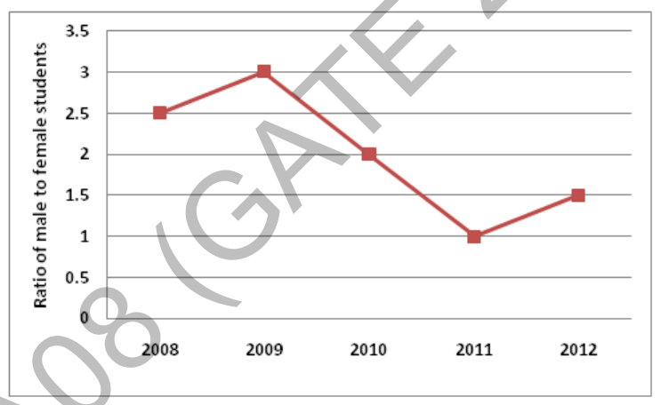

# 2014 CS2 Q64: Percent increase in male students when females doubled

## Question

(GA Set-8, Q9) The ratio of male to female students in a college for five years is plotted in the following line graph. If the number of female students doubled in 2009, by what percent did the number of male students increase in 2009?

Answer

**140**

Solution

Let the number of female students in 2008 be $F$. Then male students in 2008 are $2.5F$.

In 2009 the females are $2F$ and the ratio is 3, so the males are $3 \times 2F = 6F$.

$$\text{Increase} = \frac{6F - 2.5F}{2.5F} \times 100 = \frac{3.5}{2.5} \times 100 = 140\%$$

**Code check:** `(3*2-2.5)/2.5*100` gives `140.0`.

**Note:** the ratio values were read from the markers of the line graph (2008: 2.5, 2009: 3, 2010: 2, 2011: 1, 2012: 1.5). Only the 2008 and 2009 values are needed.

**Key idea:** use the ratio to turn counts into multiples of the base female count.

