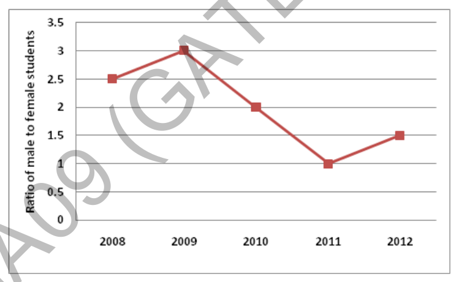

# 2014 CS3 Q64: Ratio of male students in 2012 to 2011 from a line graph

## Question

(GA Set-9, Q9) The ratio of male to female students in a college for five years is plotted in the following line graph. If the number of female students in 2011 and 2012 is equal, what is the ratio of male students in 2012 to male students in 2011?

- (A) 1:1
- (B) 2:1
- (C) 1.5:1
- (D) 2.5:1

Answer

**C**

Solution

Read the ratios from the graph: 2011 is $1$ and 2012 is $1.5$.

Let the number of female students in both years be $F$. Then

- males in 2011 $= 1 \times F = F$,
- males in 2012 $= 1.5 \times F$.

$$\frac{\text{males}_{2012}}{\text{males}_{2011}} = \frac{1.5F}{F} = 1.5 : 1$$

(A) would hold only if the ratio stayed at 1. (B) and (D) use the wrong graph values (2 is the 2010 value, 2.5 the 2008 value).

**Key idea:** with the female count fixed, the male count is proportional to the ratio.

