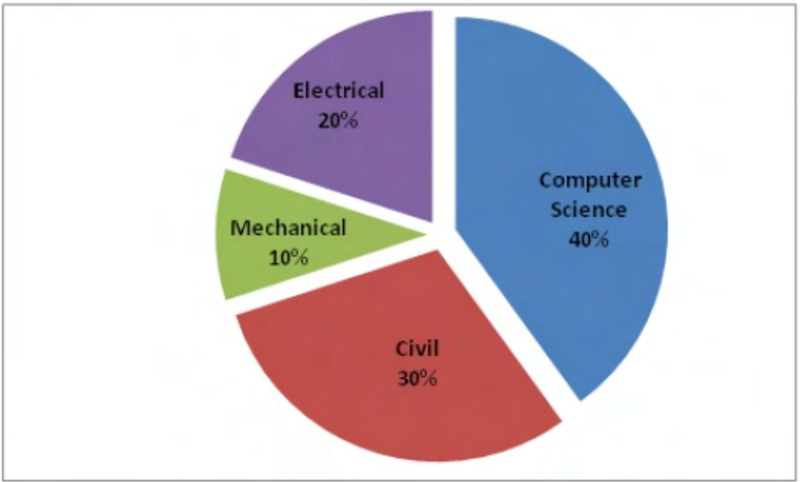

# 2015 CS1 Q8: Difference of female students from a department pie chart

## Question

The pie chart below has the breakup of the number of students from different departments in an engineering college for the year 2012. The proportion of male to female students in each department is $5:4$. There are 40 males in Electrical Engineering. What is the difference between the numbers of female students in the Civil department and the female students in the Mechanical department?

Answer

**32**

Solution

Males : females $= 5:4$ in every department, so females are $\frac{4}{9}$ of each department's students.

- Electrical: 40 males, so 32 females and $72$ students in total. This is 20% of the college.
- College total: $72 \div 0.20 = 360$.
- Civil (30%): $108$ students, so females $= 108 \times \frac{4}{9} = 48$.
- Mechanical (10%): $36$ students, so females $= 36 \times \frac{4}{9} = 16$.

$$48 - 16 = 32$$

**Key idea:** use the one known department to get the college total, then apply the 4/9 female share.

