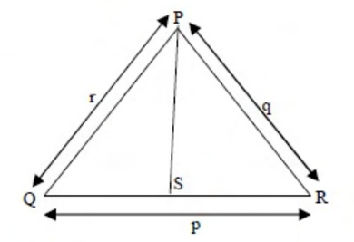

# 2015 CS2 Q7: Length of an angle bisector in a triangle

## Question

In a triangle PQR, PS is the angle bisector of $\angle QPR$ and $\angle QPS = 60^\circ$. What is the length of PS?

- (A) $\dfrac{q+r}{qr}$
- (B) $\dfrac{qr}{q+r}$
- (C) $\sqrt{q^2 + r^2}$
- (D) $\dfrac{(q+r)^2}{qr}$

Answer

**B**

Solution

$PS$ bisects $\angle QPR$ and $\angle QPS = 60^\circ$, so $\angle QPR = 120^\circ$. Here $PQ = r$ and $PR = q$.

Split the area of $\triangle PQR$ along $PS$ (each half has an angle of $60^\circ$ at $P$):

$$\tfrac12\, qr\sin 120^\circ = \tfrac12\, r\cdot PS \sin 60^\circ + \tfrac12\, q\cdot PS \sin 60^\circ$$

Since $\sin 120^\circ = \sin 60^\circ$, cancel $\tfrac12\sin 60^\circ$:

$$qr = PS\,(q + r) \;\Rightarrow\; PS = \frac{qr}{q+r}$$

Option (B). (A) has units of $1/\text{length}$, so it cannot be a length. (C) is the hypotenuse formula, which needs a right angle at $P$. (D) is dimensionless, so it cannot be a length either.

**Key idea:** equate the area of the whole triangle to the sum of the two sub-triangles on either side of the bisector.

