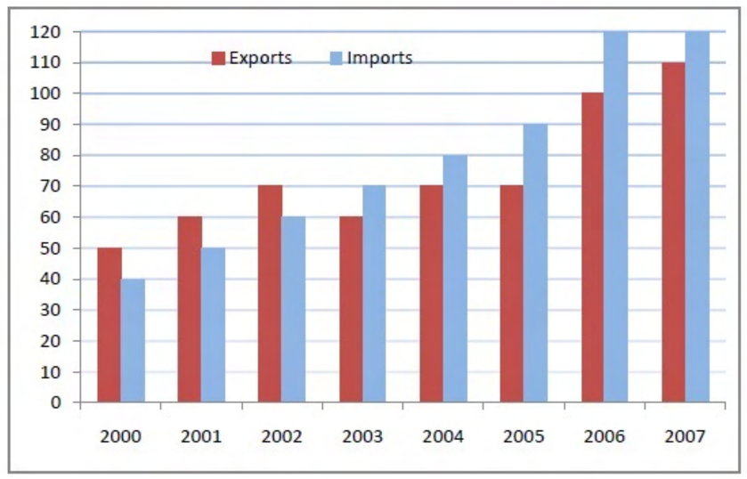

# 2015 CS3 Q8: Year with the highest combined percentage increase in imports and exports

## Question

The exports and imports (in crores of Rs.) of a country from the year 2000 to 2007 are given in the following bar chart. In which year is the combined percentage increase in imports and exports the highest?

Answer

**2006**

Solution

Add exports and imports for each year (values read from the chart), then find the percentage change from the previous year.

| Year | Exports | Imports | Total | Increase |
|---|---|---|---|---|
| 2000 | 50 | 40 | 90 | |
| 2001 | 60 | 50 | 110 | 22.2% |
| 2002 | 70 | 60 | 130 | 18.2% |
| 2003 | 60 | 70 | 130 | 0% |
| 2004 | 70 | 80 | 150 | 15.4% |
| 2005 | 70 | 90 | 160 | 6.7% |
| 2006 | 100 | 120 | 220 | **37.5%** |
| 2007 | 110 | 120 | 230 | 4.5% |

The largest jump is in **2006**.

**Reading note.** The 2006 and 2007 import bars touch the top gridline (120). The answer does not depend on small reading errors: 2006 beats the next best year (2001) by a wide margin.

**Key idea:** percentage increase $= \dfrac{\text{new} - \text{old}}{\text{old}} \times 100$, using the combined total.

