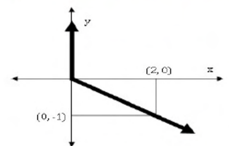

# 2015 CS3 Q9: Equation of a plotted line made of two pieces

## Question

Choose the most appropriate equation for the function drawn as a thick line, in the plot below.

- (A) $x = y - |y|$
- (B) $x = -(y - |y|)$
- (C) $x = y + |y|$
- (D) $x = -(y + |y|)$

Answer

**B**

Solution

The plot is $x$ written as a function of $y$. It has two pieces:

- For $y \ge 0$ the thick line lies on the $y$-axis, so $x = 0$.
- For $y < 0$ the line goes from the origin to $(2, -1)$ (the thin guide lines from $(2,0)$ and $(0,-1)$ meet there), so $x = -2y$.

Test option (B), $x = -(y - |y|)$:

- $y \ge 0$: $|y| = y$, so $x = -(0) = 0$. ✓
- $y < 0$: $|y| = -y$, so $x = -(y + y) = -2y$. ✓

Check the others with $y = 1$ and $y = -1$:

| Option | $x$ at $y=1$ | $x$ at $y=-1$ | Needed |
|---|---|---|---|
| A | 0 | $-2$ | 0 and 2 |
| C | 2 | 0 | 0 and 2 |
| D | $-2$ | 0 | 0 and 2 |
| **B** | **0** | **2** | 0 and 2 |

**Key idea:** $|y|$ switches the formula at $y = 0$. $y - |y|$ is $0$ for $y \ge 0$ and $2y$ for $y < 0$.

