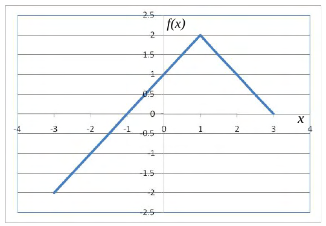

# 2016 CS2 Q65: Expression for a piecewise-linear graph with a peak at x equals 1

## Question

(GA Set-6, Q10) Choose the correct expression for $f(x)$ given in the graph.

- (A) $f(x) = 1 - |x - 1|$
- (B) $f(x) = 1 + |x - 1|$
- (C) $f(x) = 2 - |x - 1|$
- (D) $f(x) = 2 + |x - 1|$

Answer

**C**

Solution

The graph is a "tent": it rises to a peak of $2$ at $x = 1$ and falls on both sides with slope $\pm 1$. That is $f(x) = 2 - |x - 1|$.

Check with the points on the graph: $f(1) = 2$, $f(3) = 0$, $f(-3) = 2 - 4 = -2$, $f(0) = 1$. All match.

**Why the others fail.**

- (A) $1 - |x-1|$ has its peak at $1$, not $2$.
- (B) and (D) are $V$ shapes, with a minimum at $x = 1$.

**(C)**.

**Key idea:** a tent with peak 2 at $x = 1$ is $2 - |x - 1|$.

