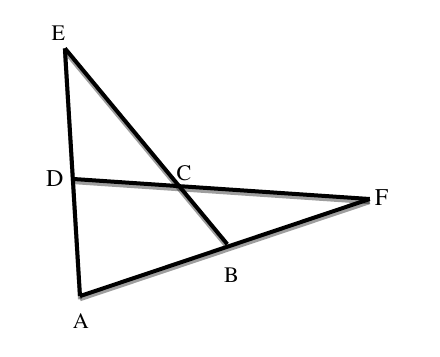

# 2018 CS Q9: Sum of two angles in a figure of crossing lines

## Question

In the figure below, $\angle DEC + \angle BFC$ is equal to ____________ .

- (A) $\angle BCD - \angle BAD$
- (B) $\angle BAD + \angle BCF$
- (C) $\angle BAD + \angle BCD$
- (D) $\angle CBA + \angle ADC$

Answer

**A**

Solution

**Read the figure.** $E, D, A$ are on one line, $A, B, F$ are on another line, and $E, C, B$ and $D, C, F$ are straight lines crossing at $C$.

**Use the exterior angle theorem twice.**

1. $\angle BCD$ is an exterior angle of triangle $EDC$ (because $E, C, B$ is a line):

$$\angle BCD = \angle DEC + \angle EDC$$

2. $\angle EDC = \angle EDF$ is an exterior angle of triangle $ADF$ (because $A, D, E$ is a line). Also $\angle DAF = \angle BAD$ and $\angle DFA = \angle BFC$:

$$\angle EDC = \angle BAD + \angle BFC$$

Substitute step 2 into step 1:

$$\angle BCD = \angle DEC + \angle BAD + \angle BFC$$

$$\boxed{\angle DEC + \angle BFC = \angle BCD - \angle BAD}$$

**Numeric check:** in a to-scale re-drawing of this figure, $\angle DEC+\angle BFC = 60.37^\circ$ and $\angle BCD-\angle BAD = 60.37^\circ$. Options B, C, D came to $119.6^\circ$, $218.0^\circ$ and $142.0^\circ$.

**Key idea:** an exterior angle of a triangle equals the sum of the two opposite interior angles.

