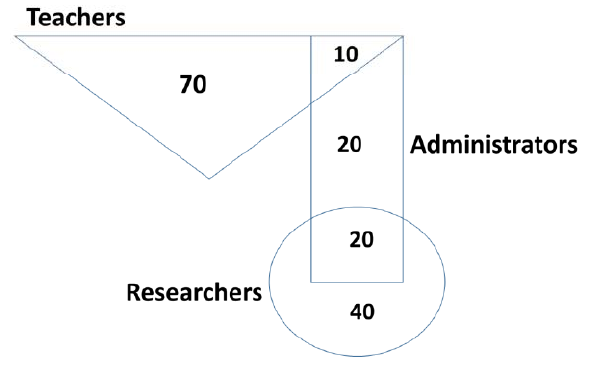

# 2019 CS2 Q7: Percentage of administrators from a Venn diagram

## Question

In the given diagram, teachers are represented in the triangle, researchers in the circle and administrators in the rectangle. Out of the total number of the people, the percentage of administrators shall be in the range of ___________.

- (A) 0 to 15
- (B) 16 to 30
- (C) 31 to 45
- (D) 46 to 60

Answer

**C**

Solution

**Reading the figure.**

| Region | People |
|---|---|
| Teachers only | 70 |
| Teachers and administrators (corner of the rectangle inside the triangle) | 10 |
| Administrators only | 20 |
| Administrators and researchers | 20 |
| Researchers only | 40 |

Total $= 70 + 10 + 20 + 20 + 40 = 160$.

Administrators $= 10 + 20 + 20 = 50$.

$$\frac{50}{160} \times 100 = 31.25\%,$$

which lies in **31 to 45**.

**Why the others fail:** 31.25 is above 30 (so not B) and well above 15 (not A). It is below 46 (not D).

**Key idea:** add every region inside the rectangle, divide by the sum of all regions.

