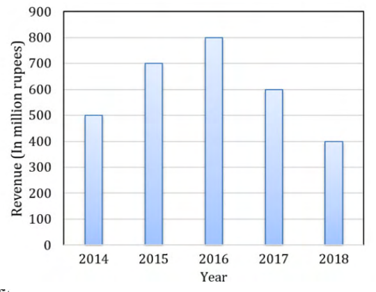

# 2020 CS Q10: Aggregate profit or loss from a revenue bar graph

## Question

The total revenue of a company during 2014-2018 is shown in the bar graph. If the total expenditure of the company in each year is 500 million rupees, then the aggregate profit or loss (in percentage) on the total expenditure of the company during 2014-2018 is ______.

- (A) 16.67 % profit
- (B) 16.67 % loss
- (C) 20 % profit
- (D) 20 % loss

Answer

**C**

Solution

**Read the bars (million rupees):** 500, 700, 800, 600, 400.

| Quantity | Value |
|---|---|
| Total revenue | $500+700+800+600+400 = 3000$ |
| Total expenditure | $5 \times 500 = 2500$ |
| Profit | $3000 - 2500 = 500$ |

The percentage is taken **on the expenditure**:

$$\frac{500}{2500} \times 100 = 20\%\ \text{profit}.$$

**Why the others fail:**

- **(A) and (B):** 16.67 % is $500/3000$, which takes the profit as a share of *revenue*. The question asks for the percentage on expenditure.
- **(B) and (D):** revenue is higher than expenditure, so it is a profit, not a loss.

**Key idea:** profit % is measured on the cost (expenditure) unless the question says otherwise.

