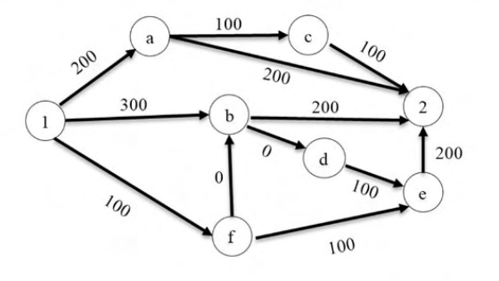

# 2020 CS Q5: Cheapest route with toll booths from node 1 to node 2

## Question

There are multiple routes to reach from node 1 to node 2, as shown in the network.

The cost of travel on an edge between two nodes is given in rupees. Nodes 'a', 'b', 'c', 'd', 'e', and 'f' are toll booths. The toll price at toll booths marked 'a' and 'e' is Rs. 200, and is Rs. 100 for the other toll booths. Which is the cheapest route from node 1 to node 2?

- (A) 1-a-c-2
- (B) 1-f-b-2
- (C) 1-b-2
- (D) 1-f-e-2

Answer

**B**

Solution

**Reading of the question.** The total cost of a route is the sum of its edge costs plus the toll at every toll booth (node) passed on the way. Node 2 is the destination and not a toll booth.

| Route | Edge costs | Tolls | Total |
|---|---|---|---|
| (A) 1-a-c-2 | 200+100+100 = 400 | a 200 + c 100 = 300 | **700** |
| (B) 1-f-b-2 | 100+0+200 = 300 | f 100 + b 100 = 200 | **500** |
| (C) 1-b-2 | 300+200 = 500 | b 100 | **600** |
| (D) 1-f-e-2 | 100+100+200 = 400 | f 100 + e 200 = 300 | **700** |

So (B) is the cheapest of the four.

**Check against all routes.** I listed every route from 1 to 2 that does not repeat a node. The costs are 500 (1-f-b-2), 600 (1-a-2 and 1-b-2), 700 (1-a-c-2 and 1-f-e-2), 900 (1-f-b-d-e-2) and 1000 (1-b-d-e-2). Nothing beats 500.

**Key idea:** for a route, add the edge costs and the tolls at the intermediate nodes. The zero-cost edge f→b is what makes the longer route cheaper.

