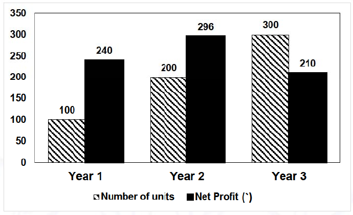

# 2021 CS2 Q9: Ratio of selling prices from a profit chart

## Question

The number of units of a product sold in three different years and the respective net profits are presented in the figure above. The cost/unit in Year 3 was Rs 1, which was half the cost/unit in Year 2. The cost/unit in Year 3 was one-third of the cost/unit in Year 1. Taxes were paid on the selling price at 10%, 13% and 15% respectively for the three years. Net profit is calculated as the difference between the selling price and the sum of cost and taxes paid in that year.

The ratio of the selling price in Year 2 to the selling price in Year 3 is ______.

- (A) 4:3
- (B) 1:1
- (C) 3:4
- (D) 1:2

Answer

**A**

Solution

**Costs per unit.** Year 3: Rs 1. Year 2: Rs 2 (Year 3 is half of it). Year 1: Rs 3 (Year 3 is a third of it).

Let $S_i$ be the total selling price (revenue) in year $i$. Then net profit $=S_i-\text{cost}-\text{tax}=(1-t_i)S_i-\text{cost}$.

| Year | Units | Total cost | Tax | Equation | $S_i$ |
|---|---|---|---|---|---|
| 1 | 100 | 300 | 10% | $0.90S_1-300=240$ | 600 |
| 2 | 200 | 400 | 13% | $0.87S_2-400=296$ | 800 |
| 3 | 300 | 300 | 15% | $0.85S_3-300=210$ | 600 |

Ratio of total selling prices in Year 2 to Year 3: $800:600=4:3$. (A).

Per unit the ratio would be Rs 4 : Rs 2 $=2:1$, which is not among the options. So the question means the **total** selling price.

**Key idea:** net profit $=(1-\text{tax rate})\times\text{selling price}-\text{cost}$, so solve for the selling price each year.

